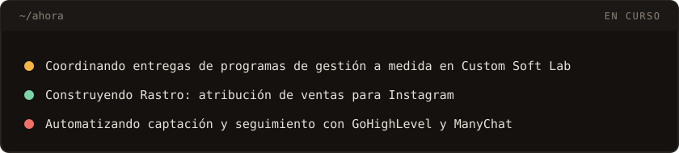

<!-- Banner opcional:  -->

**Responsable técnico de proyectos SaaS · Front-end · Automatización comercial**

Llevo 3 años en proyectos web. Hoy coordino la construcción y la entrega de programas de gestión a medida para pymes: desde el primer cuestionario del cliente hasta el servidor en producción.

---

### `~/sobre-mi`

Soy **técnico jefe en Custom Soft Lab**, un estudio de software a medida que entrega programas de gestión para pymes en 30 días. Coordino al equipo técnico, reviso la calidad de cada entrega, me ocupo de los despliegues y los dominios, y acompaño a cada cliente durante todo el proyecto.

Mi forma de trabajar parte del negocio, no de la tecnología: primero entiendo cómo trabaja el cliente y qué le hace perder tiempo, después lo convierto en una especificación clara y recién ahí se construye. Trabajo con desarrollo asistido por IA, con reglas estrictas de calidad y seguridad, y nada se da por terminado sin pruebas.

---

### `~/proyectos`

#### Rastro — Atribución de ventas para Instagram
*SaaS propio · Cofundador, junto a dos socios*

Aplicación web para empresas que venden por mensajes de Instagram. Muestra de qué reel, historia o anuncio llegó cada persona que escribe, cómo siguió la conversación con el equipo y cuánto dinero dejó cada contenido.

- **Atribución por contenido:** cada conversación queda ligada al reel, la historia o el anuncio que la originó.
- **Seguimiento del equipo:** cómo y cuándo se respondió a cada persona, hasta la venta.
- **Calidad antes de publicar:** batería de pruebas automáticas obligatoria y revisión independiente de todo lo que toca sesiones, permisos o datos de clientes.
- **Despliegue continuo:** cada cambio aprobado se publica solo y el servidor no cambia de versión si la nueva no responde.

#### CRM inmobiliario para una red de oficinas
*Custom Soft Lab · Técnico jefe · En desarrollo*

Programa de gestión para una inmobiliaria con varias oficinas, más de 6.000 compradores y 12.000 propiedades registradas. Reemplaza al CRM que usaban y genera los documentos que exige la normativa de su comunidad.

- **Captación y cartera:** fichas de inmueble con fotos, expediente privado y contratos de venta.
- **Cruce automático:** cada demanda de compra se cruza con los inmuebles por lotes, pensado para decenas de miles de fichas.
- **Bandeja de entrada:** los leads llegan por canal y se reparten entre los agentes según el inmueble o el turno.
- **Permisos por oficina:** cada usuario ve solo su empresa, su oficina o lo suyo.

#### Stock de vehículos para un concesionario de ocasión
*Custom Soft Lab · Técnico jefe*

Programa instalado en el servidor del propio cliente para gestionar su stock de coches y prepararlo para los portales de venta.

- **Ficha de cada coche:** fotos, estados y quitado automático del fondo para las fotos de estudio.
- **Usuarios por rol:** el equipo entra por invitación y cada uno ve lo que le toca.
- **Datos del cliente, siempre suyos:** descarga completa de todos los datos con un botón y copia de seguridad cada noche, con las fotos incluidas.

#### Automatizaciones comerciales
*GoHighLevel y ManyChat*

Sistemas de captación y seguimiento para profesionales y empresas de formación.

- **Embudos de venta** con vídeo y calendario de reservas incrustado.
- **Avisos al teléfono del dueño** cada vez que entra un lead por un formulario.
- **Seguimiento automático:** recordatorios, correos y mensajes por WhatsApp.
- **Respuestas en Instagram y WhatsApp** desde ManyChat.

---

### `~/stack`

| `front-end/` | `back-end/` | `datos/` |
| :---: | :---: | :---: |
|  |  |  |
| **`infraestructura/`** | **`herramientas/`** | **`automatización/`** |
|  |  |        |

También: PM2, Railway, Hostinger, DNS y certificados.

---

### `~/como-trabajo`

`01` **Especificación antes que código.** Cada proyecto arranca con un documento que dice qué se construye, para quién y cómo se va a comprobar que funciona.

`02` **Pruebas antes de publicar.** Nada sube a producción sin pruebas en verde y una revisión.

`03` **Seguridad por defecto.** Claves fuera del código, permisos comprobados en el servidor y datos de ejemplo siempre inventados.

`04` **Comunicación clara.** El cliente sabe en cada momento qué está hecho, qué falta y qué necesitamos de él.

---

### `~/contacto`

**¿Hablamos?** Escribime a [marcosduran14235@gmail.com](mailto:marcosduran14235@gmail.com)

